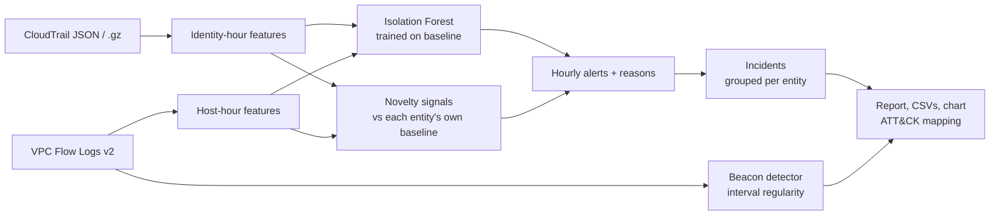

# Cloud Anomaly Detection: CloudTrail & VPC Flow Logs

Behavioural anomaly detection for AWS. It learns what "normal" looks like for **each IAM identity** (from CloudTrail) and **each host** (from VPC Flow Logs), then flags hours that break that pattern: compromised credentials, privilege escalation, disabled logging, bulk S3 downloads, crypto-mining in unused regions, port scans, exfiltration and C2 beaconing.

Every alert comes with **plain-English reasons** ("source IP never seen for this identity", "1,144 distinct destination ports (381x typical)") and **likely MITRE ATT&CK techniques**. Hourly alerts are grouped into **incidents**, so one compromised host is one ticket, not forty.


## Results on the included dataset

The generator creates 14 days of realistic activity for a small AWS account (13 users, 25 hosts, about 8k CloudTrail events and 53k flow records) and injects 7 labelled attacks in the last 4 days. The model trains on the first 10 days.

| Metric | Result |
|---|---|
| Attacks detected | **7 / 7** |
| Incidents raised | 6 (+1 beaconing channel) |
| False-positive incidents | 1 (LOW severity) |
| Alerts in the 10-day baseline | 0 |

| Attack injected | Detected as | ATT&CK |
|---|---|---|
| Stolen keys used from a new IP at 3am: IAM recon + CreateAccessKey / AttachUserPolicy | HIGH, `dev.sarah` | T1078.004, T1087.004, T1098 |
| Same attacker: StopLogging, DeleteDetector, StopConfigurationRecorder | HIGH, `dev.sarah` (same incident) | T1562.008 |
| 650 S3 GetObject calls in one hour | MEDIUM, `analyst.raj` | T1530 |
| 40 EC2 instances launched in ap-southeast-1 at 2am | HIGH, `ops.mike` | T1496, T1535 |
| Internal port scan (1,200 probes, mostly rejected) | HIGH, `10.0.1.23` | T1046 |
| 4.5 GB sent to a Tor exit node | HIGH, `10.0.1.23` (same incident) | T1041 |
| C2 beacon every 5 minutes to an external host | Beacon detector + MEDIUM incident, `10.0.2.14` | T1071.001 |

Full output: [docs/sample_report.md](docs/sample_report.md)

## How it works



**Features per identity-hour (CloudTrail):** API volume, distinct APIs, error rate (AccessDenied probing), sensitive IAM and logging calls, IAM/STS recon calls, S3 reads, EC2 launches, new source IP, new region, new user agent, off-hours.

**Features per host-hour (VPC Flow Logs):** flows, MB out, MB to the internet, distinct destination IPs and ports, reject ratio, never-seen external destinations, off-hours.

### Why a hybrid model, not Isolation Forest alone

"New IP" or "new region" is measured against the entity's own baseline, so by definition it is always 0 during training. An Isolation Forest never learns to split on it. The chart above shows the result: several real attacks score *below* the forest's 99th-percentile line.

The detector therefore combines two views:

- **anomaly_score**: the Isolation Forest (log-scaled, robust-scaled features), meaning how unusual the hour looks overall
- **novelty**: how many hard signals the baseline never produced (new IP, region or client, or a metric above 1.5x its training maximum)

An hour alerts when novelty is 2 or more, or when novelty is 1 **and** the hour is off-hours or above the forest's p99. Severity is HIGH for 3 or more signals, MEDIUM for 2 or off-hours, and LOW otherwise.

### Beaconing

Hourly totals hide beacons, because a few KB an hour looks normal. The beacon detector looks at the **timing** between connections for each source-destination pair instead. Many small connections at a near-constant interval (jitter under 10%) are flagged.

## Quick start

```bash
python -m venv .venv && source .venv/bin/activate
pip install -r requirements.txt

python -m anomaly demo          # generate data, detect, score against ground truth
```

```
6 incidents, 1 beaconing channel(s)

  [HIGH  ] CloudTrail dev.sarah    Sep 12 03:00  31 API calls (4x typical); 12 distinct APIs; 39% error rate
                                                ATT&CK: T1580, T1098, T1087.004, T1078.004
  [HIGH  ] VPC Flow   10.0.1.23    Sep 12 04:00  1,203 flows (241x typical); ... 1,144 distinct destination ports (381x typical)
                                                ATT&CK: T1046, T1041, T1071
  [HIGH  ] CloudTrail ops.mike     Sep 14 02:00  45 API calls (6x typical); 40 EC2 instances launched; source IP never seen ...
  ...
  [BEACON] 10.0.2.14 -> 91.219.236.18:8443 every 300s (1080 connections, jitter 0.009)

Ground truth: detected 7/7 attacks, 1 false-positive incident(s)
```

### On your own logs

```bash
# CloudTrail: a .json / .json.gz file or the folder synced from your trail's S3 bucket
aws s3 sync s3://<trail-bucket>/AWSLogs/<account>/CloudTrail/us-east-1/2026/09/ ./ct/

python -m anomaly detect --cloudtrail ./ct --flowlogs ./vpc_flow_logs.log --train-days 10
```

Use a baseline period you believe is clean. `--train-end 2026-09-11` sets it explicitly.

Outputs go to `output/`: `report.md`, `incidents.csv`, `hourly_alerts.csv` and `anomaly_timeline.png`.

## Project structure

```
anomaly/
  generate.py    synthetic CloudTrail + VPC Flow Logs with labelled attacks
  loaders.py     real-format parsers (CloudTrail JSON/.gz/folders, Flow Logs v2)
  features.py    identity-hour and host-hour features with per-entity baselines
  model.py       Isolation Forest + novelty signals + explanations
  beacon.py      interval-regularity C2 beacon detection
  incidents.py   alert grouping and ground-truth evaluation
  mitre.py       reason to ATT&CK technique mapping
  report.py      markdown report and timeline chart
  cli.py         demo / generate / detect
docs/            sample report and chart
tests/           pytest (end-to-end detection + unit tests)
```

## Tests

```bash
pip install -r requirements-dev.txt
pytest -q
```

The 11 tests cover: all 7 attacks detected end to end, the false-positive ceiling, zero alerts in the baseline, explanations and ATT&CK mapping, the flow-log parser (header and NODATA rows), the assumed-role CloudTrail principal, beacon detection, novelty logic, the ATT&CK ratio rules and incident grouping.

## Limitations and next steps

- The baseline must be clean. An attacker already active during training becomes "normal".
- Role sessions are tracked per session name. Mapping sessions back to the human (via `sourceIdentity`) would give better per-person baselines.
- Next: read directly from S3 or Athena, stream alerts to Security Hub as custom findings, and add peer-group baselines (compare a user with others in the same team).
